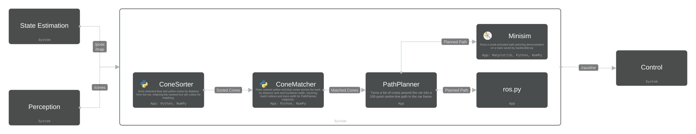
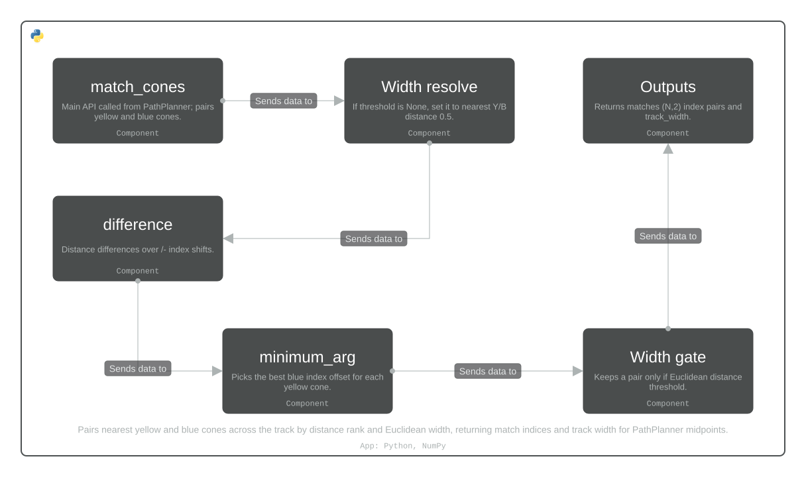
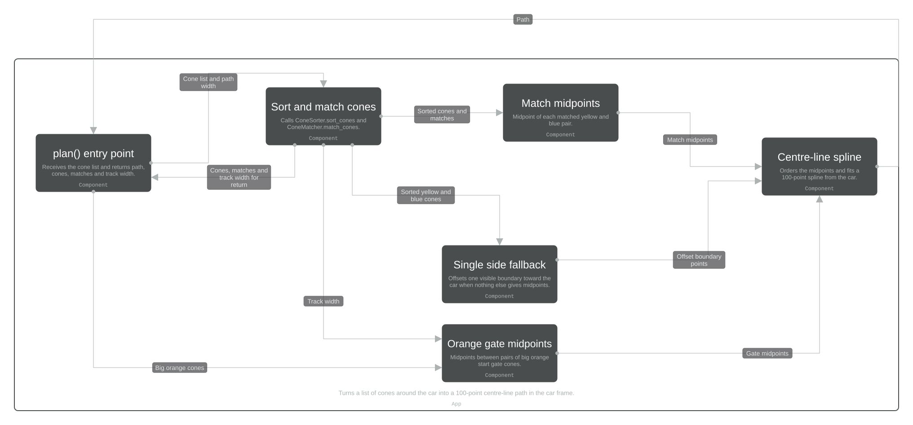

# Path Planning Components


## Cone Sorting

The **ConeSorter** is the first processing component of the Path Planning algorithm. It is called by `PathPlanner.plan()` after cone data is received from Perception or State Estimation and converted into internal `Cone` objects.

Its main purpose is to organise the detected cones by colour and distance from the car, preparing them for the ConeMatcher.

### Inputs

The `sort_cones()` method takes the following inputs:

- **Cones:** A list of `Cone` objects containing their colour and 2D coordinates `(x, y)`.
- **Reference point:** The position used to calculate distances, defaulting to `(0, 0)`, which represents the car's position in its local coordinate frame.
- **Maximum cones per side:** The maximum number of cones to keep for each colour, defaulting to `4`.

### How It Works

1. **Distance calculation:** Calculates the Euclidean distance of each cone from the reference point using `euclidean_distance()` from `mathUtils.py`.
2. **Sorting:** Sorts the cones in ascending order of distance, placing the closest cones first.
3. **Colour separation:** Separates the sorted cones into yellow and blue groups. Orange and unknown cones are excluded from the sorter's output.
4. **Cone selection:** Keeps only the nearest four cones of each colour by default, limiting the number of cones used for matching.

### Outputs

The `sort_cones()` method returns four NumPy arrays:

| Output | Description |
|---|---|
| `yellow_cones_sorted` | Yellow cone objects sorted nearest-first |
| `yellow_distances` | Corresponding distances of the yellow cones |
| `blue_cones_sorted` | Blue cone objects sorted nearest-first |
| `blue_distances` | Corresponding distances of the blue cones |

These arrays are returned to `PathPlanner.plan()`, which passes them to `ConeMatcher.match_cones()` to identify potential yellow-blue cone pairs across the track.

The accepted matches are then used by PathPlanner to calculate centrepoints and generate a smoothed path that is published for the Control team to follow.

**Implementation:** `ft_euclid/ConeSorter.py`

## Cone Matching



[ConeMatcher Component Diagram on IcePanel](https://app.icepanel.io/landscapes/W3k5yfoNP87dJQHdxNC2/versions/latest/diagrams/editor?diagram=BIOdfEZEgK&model=j8TPE0eipC)

The **ConeMatcher** is the second processing component of the Path Planning algorithm. `PathPlanner.plan()` calls `ConeMatcher.match_cones()` with the yellow and blue arrays returned by `ConeSorter.sort_cones()`.

Its main purpose is to pair yellow and blue cones that sit across the track from each other. Pairing uses distance from the car: each yellow cone is matched to the blue cone, within a small rank window, whose distance from the car is closest to its own. A Euclidean width check then drops pairs whose separation is at least the width threshold. `PathPlanner` turns the accepted pairs into midpoints for the centreline.

### Inputs

`PathPlanner.plan()` constructs the matcher as `ConeMatcher(index_threshold=3, width_threshold=path_width)`. The `path_width` argument defaults to `5.75`. Passing `None` leaves the width unset so the first `match_cones()` call can derive it.

The constructor stores those two arguments as:

- **Index threshold:** `MATCH_INDEX_THRESHOLD`. How many ranks either side of the current cone to search. The yellow and blue arrays arrive sorted by distance from the car, so the search stays inside this window.
- **Width threshold:** `MAX_TRACK_WIDTH_THRESHOLD`. The maximum Euclidean distance allowed between a matched yellow cone and blue cone. `None` means the threshold has not been set yet.

The `match_cones()` method takes four arrays, in this order:

- **Sorted yellow distances:** Distance of each yellow cone from the car, nearest first.
- **Sorted blue distances:** Distance of each blue cone from the car, nearest first.
- **Sorted yellow cones:** Yellow `Cone` objects in that same order. Positions are read from `cone.pos`.
- **Sorted blue cones:** Blue `Cone` objects in that same order.

### Steps

1. **Resolve the track width:** When `MAX_TRACK_WIDTH_THRESHOLD` is `None` and both colours are present, `calculate_path_width()` sets it to the Euclidean distance between the first yellow cone and the first blue cone, plus a `0.5` m margin. With ConeSorter's nearest-first order, those are the nearest yellow cone and the nearest blue cone. When the threshold is `None` and either colour is missing, `match_cones()` returns no matches and leaves the threshold as `None`.
2. **Align the distance arrays:** When the two distance arrays have different lengths, `make_array_same_lengths()` from `mathUtils.py` pads the shorter one. `difference()` pads again if the lengths still differ, so the shift comparison can run element by element.
3. **Compare distance ranks:** `difference()` takes the absolute difference between each yellow distance-from-car and the blue distances at every index offset from `-MATCH_INDEX_THRESHOLD` to `+MATCH_INDEX_THRESHOLD`, including the aligned comparison at offset `0`.
4. **Pick the closest rank:** `minimum_arg()` chooses, for each yellow index `i`, the offset whose absolute difference is smallest. The candidate blue index is `i + offset`. Offset `0` keeps the same rank, a positive offset selects a blue cone further down the sorted list, and a negative offset selects one further up. Each yellow index is chosen independently, so the same blue index can be selected for more than one yellow cone.
5. **Apply the width gate:** The pair is kept only when both indices exist in the cone arrays and `euclidean_distance()` between the two `cone.pos` values is less than `MAX_TRACK_WIDTH_THRESHOLD`. Any other candidate is omitted. `place_virtual_cones()` is an empty stub, and `match_cones()` does not call it.

### Outputs

The `match_cones()` method returns two values:

| Output | Description |
|---|---|
| `matches` | NumPy `int` array of shape `(N, 2)`. Each row is `[yellow_index, blue_index]` into the sorted cone arrays. No accepted pairs gives shape `(0, 2)`. |
| `track_width` | `MAX_TRACK_WIDTH_THRESHOLD` after this call. That is the value passed into the constructor, or the derived nearest-cone distance plus `0.5` m when the constructor value was `None`. It stays `None` when the width could not be derived. |

`PathPlanner.plan()` passes `matches` to `find_match_midpoints()`, which takes the midpoint of the line between each accepted yellow cone and blue cone. Those midpoints are the yellow-blue centrepoints. `track_width` is returned from `plan()` with the path, and it is also the width used when pairing big-orange start-gate cones.

**Implementation:** `ft_euclid/ConeMatcher.py`

## Mini Simulator

The Path Planning mini simulator is a light weight mini simulator that allows quick checks of algorithm performance before testing with the full FT stack in EUFS. It runs quickly and only needs track_data.npz and the ft_euclid planner code. It's main purpose is to act as a unit test for path planning.

### How to run the mini-sim
1. First run trackbuilder.py, click and drag to make your track. Try to match the end of the track with the start to create a full loop, it should snap to the beginning.

2. Press enter to save the track. This will go to a track_data.npz file.

3. Run path_planner_sim.py, this will read the latest contents of the track_data.npz file and the mini sim should be operational.

### Inputs
path_planner_sim.py takes no command-line arguments. Its input is the track_data.npz file created by trackbuilder.py, which must be in the same directory as path_planner_sim.py.

track_data.npz contains four named arrays, written by trackbuilder.py’s np.savez() call and read back by name with np.load(). Every point is  (x, y), in metres in the global (track) frame:

- blue_cones: shape (B, 2). Blue cones, 1.5 m left of the centerline.
- yellow_cones: shape (Y, 2). Yellow cones, 1.5 m right of the centerline.
- centerline: shape (M, 2), M ≥ 2. The smoothed track centre, one point every 0.5 m. The sim uses only the first two points, to set the vehicle’s start position and heading.
- big_orange_cones: shape (2, 2). The two start-gate cones. The sim treats this array as optional and uses no orange cones if it’s missing.

Hard-coded parameters include: 10 m lookahead, 0.5 m moved per frame, 0.1 m path-point filter, 120 frames that repeat, 100 ms interval, ±50 m axes.

### Steps
path_planner_py() runs once and sets everything up, including:

- creating a PathPlanner instance
- loading the track from track_data.npz
- converting every cone position into a Cone object in cone_list
- drawing all cones faintly as a static background
- creating the empty plot elements that are updated each frame (vehicle marker, path line, match lines, highlighted matched cones)
- placing the vehicle at centerline[0], heading toward centerline[1]
- registering update() with FuncAnimation and opening the window with plt.show()

After the window opens, all per-frame work happens in update(). path_planner_py() resumes only when the window is closed, and then returns the animation object.
update() is ran every 100 ms. Each call to update() performs one simulation step:

- _transform_visible_cones() keeps cones within 10 m that are in front of the vehicle and converts them into the vehicle frame (x forward, y left). Those cones are passed to planner.plan().
- _build_match_artifacts() converts each matched yellow/blue pair back to the global frame. update() then draws them as magenta lines and highlights the matched cones.
- update()then removes path points within 0.1 m of the vehicle or behind it, converts the rest to the global frame, and draws them starting from the vehicle’s position.
- _advance_vehicle() moves the vehicle 0.5 m toward the first path point and turns it to face along the first path segment. If no valid path points remain, the vehicle creeps 0.15 m straight ahead instead.
- Handle errors: any exception is printed with the frame number and position, and the path line is hidden.

### Outputs
- An interactive animated plot: track cones, the vehicle (red), the planned path (green), cone matches (magenta) and matched cones (cyan and orange).
- Console output: cone counts at startup and any planning errors per frame.
- Return value: the FuncAnimation object, available only after the window is closed.
- No files, metrics or logs are written. track_width is returned by plan() but never used.

### Limitations

| Limitation | Description |
|---|---|
| Separate track generation | Tracks are made by `trackbuilder.py` and saved to `track_data.npz`, which `path_planner_sim.py` then loads. Testing a different track means running `trackbuilder.py` first, then the sim. Both scripts use their own directory for this file, so they must be in the same folder. The sim takes no command-line arguments, so you can't choose a track at launch, and each new track overwrites the last one. |
| Path setup | `sys.path.insert()` runs after the `ft_euclid` imports, so it has no effect. `ft_euclid` must already be importable. |
| Vehicle can get permanently stuck | Once the vehicle fails to move in a frame, the planner gets identical input on every later frame, so it stops for good if the filtered path has only one point, or `plan()` raises an exception, which then prints the same error every frame. |
| Movement and heading differ slightly | The vehicle moves toward the first path point, but its heading is set from the direction between the first and second path points. This may be intended (lining up with the path ahead), but on curves the direction the vehicle moves and the direction it faces differ slightly. |
| Fixed view | The axes are fixed at ±50 m and don't follow the vehicle. This matches `trackbuilder.py`'s drawing area, so it only matters for tracks from other sources. |
| Path Planning scope | The sim doesn't test whether the car can drive the resulting path. It has no vehicle dynamics or steering limits, so path feasibility wouldn't be able to be tested in this mini-sim. |

## PathPlanner



[PathPlanner Component Diagram on IcePanel](https://app.icepanel.io/landscapes/W3k5yfoNP87dJQHdxNC2/versions/latest/diagrams/editor?diagram=I7xmacByVr)

`plan()` is the entry point in `ft_euclid/PathPlanner.py`. It receives `cones_data` and `path_width`, calls `ConeSorter.sort_cones()` and `ConeMatcher.match_cones()`, then builds centre points and a spline. The car sits at the origin, so every position passed into `plan()` is in the car frame. The ROS node `path_planning_visualiser` publishes the resulting path on `/raceline`.

### Inputs

`plan()` is called as:

```python
path, yellow_cones, blue_cones, matches, track_width = planner.plan(
    cones_data, path_width=5.75
)
```

`cones_data` is a list of `Cone` objects. Each cone has a type and an `(x, y)` position. The types `plan()` uses are `YELLOW`, `BLUE` and `BIG_ORANGE`. The ROS helper also converts small orange cones to `SMALL_ORANGE`. `plan()` never reads that type.

`path_width` is the maximum spacing allowed for a yellow cone and a blue cone to be treated as a pair. The default is 5.75 m. Passing `None` makes the matcher set the width from the distance between the nearest yellow cone and the nearest blue cone, plus 0.5 m.

`PathPlanner` sorts from a reference point of `(0, 0)`.

### Steps

1. A new `ConeSorter` is created with the default cap of 4 cones per side. Cones are sorted by Euclidean distance from the origin, then the nearest 4 yellow cones and the nearest 4 blue cones are kept, together with those distances. The sort itself is described under Cone Sorting.
2. A `ConeMatcher` is created with `index_threshold=3` and `width_threshold` set to `path_width`. For each yellow cone it looks for a blue partner within 3 places in the distance-sorted lists. A pair is kept only if the two cones are closer together than the width threshold. If there is nothing to match against, for example when only one side is visible and a width could not be derived, it returns no matches. The match itself is described under Cone Matching.
3. Each kept pair is joined with a line, and the midpoint of that line is added to the centre-point list. `find_match_midpoints()` does this.
4. `find_orange_gate_midpoints` runs on every cone in `cones_data` whose type is `BIG_ORANGE`, including when yellow and blue midpoints already exist. The matcher only pairs yellow and blue. Two big orange cones are paired when the distance between them is greater than 2.5 m and less than the current track width. If the matcher could not resolve a width (`track_width` is `None`), the upper limit is dropped and only the 2.5 m minimum applies. The midpoint of each pair is appended to the list.
5. `single_side_fallback` runs only if the centre-point list is still empty after matching and orange gate pairing. It needs at least two cones on one colour and none on the other. It walks the visible boundary, takes the local tangent, and offsets each point 1.75 m along the normal that points toward the car. If both colours are present but no midpoints were produced, or if fewer than two cones remain on the only visible side, the fallback returns nothing and `plan()` returns an empty path.
6. The midpoints are sorted by squared distance from the car. The origin is prepended so the path starts at the car. `splinify.make_spline` then samples 100 points along the curve. With two centre points the result is a straight line. With three or more, the curve is a sequence of quadratic Bézier segments that pass through the midpoints between adjacent centre points, using each intermediate centre point as a control point.

### Outputs

`plan()` returns five values.

| Output | Description |
|---|---|
| `path` | An `(N, 2)` array of centre-line points, or an empty `(0, 2)` array when no path could be built |
| `yellow_cones` | The sorted, truncated yellow array from the sorter |
| `blue_cones` | The sorted, truncated blue array from the sorter |
| `matches` | Integer index pairs into those arrays, one pair per matched yellow and blue cone |
| `track_width` | The width the matcher actually used, including a value it derived when `path_width` was `None` |

### ROS interface

The ROS 2 node is `PathPlanningVisualiser` (node name `path_planning_visualiser`), started by the `ros` console script in the `ft_path_planning` package. There is no launch file in the package. All of the subscriptions and publishers use a queue size of 1.

| Topic | Type | Role | When it is used |
|---|---|---|---|
| `/cones` | `eufs_msgs/ConeArrayWithCovariance` | subscribed | Perception mode (`use_slam` is false) |
| `/map` | `eufs_msgs/ConeArrayWithCovariance` | subscribed | SLAM mode (`use_slam` is true) |
| `/pose` | `geometry_msgs/PoseStamped` | subscribed | SLAM mode, for the car position and yaw |
| `/raceline` | `eufs_msgs/PointArrayStamped` | published | The planned path, `frame_id` `base_footprint` |
| `/marker` | `visualization_msgs/MarkerArray` | published | RViz markers, `frame_id` `/base_footprint` |

The `use_slam` parameter is a boolean and defaults to `false`. It is read once at startup into `enable_slam`. When it is false, each `/cones` message is converted to `Cone` objects and passed to a new `PathPlanner`. If the cone array is empty, if `plan()` raises, or if the returned path has fewer than 2 points, nothing is published. Otherwise the path is published on `/raceline` with no timestamp, old markers are cleared with `DELETEALL`, red spheres are drawn on the path waypoints, and blue line strips are drawn between each matched yellow and blue cone, all in the `ft_line` namespace. After a successful perception publish, `use_slam` is set back to `enable_slam`.

When `use_slam` is true, `/cones` is ignored. `/map` cones are transformed into the car frame and passed to a reused `PathPlanner` instance, with `path_width` taken from the node (initially 5.75 m, then whatever `plan()` last returned as `track_width`). Replanning is limited to once every 0.5 s. The path and cones are stored in the odom frame and transformed back into the current `base_footprint` frame on every `/map` callback, so a cached plan stays aligned with the car between replans. A SLAM path is treated as invalid if it has fewer than 5 points or any point with `x < 0`. In that case the node logs a warning, sets `use_slam` to `false`, and does not publish, so the next `/cones` message can be used instead. A valid SLAM `/raceline` message includes a timestamp, and only points with `x > 0` are published. The SLAM marker array uses the same sphere and line-strip shapes, and it is not cleared with `DELETEALL` first.

`/pose` must have arrived before SLAM planning runs. Empty `/map` arrays are skipped.

### Parameters

| Name | Default | Where it is set |
|---|---|---|
| `path_width` | 5.75 m | Argument to `plan()`. The node also holds this value and, in SLAM mode, overwrites it with the `track_width` returned by `plan()`. Pass `None` to derive it from the nearest yellow and blue cones plus 0.5 m. |
| `max_cones_per_side` | 4 | `ConeSorter` default, used because `plan()` constructs the sorter with no arguments |
| `index_threshold` | 3 | Passed to `ConeMatcher` from `plan()` |
| `min_gap` | 2.5 m | Lower distance bound for pairing big orange cones in `find_orange_gate_midpoints` |
| fallback `offset` | 1.75 m | Fixed offset in `single_side_fallback`. It is not computed from `track_width`. |
| spline `points` | 100 | Passed to `splinify.make_spline` |
| `use_slam` | `false` | ROS parameter on `path_planning_visualiser` |
| `path_update_interval` | 0.5 s | SLAM replanning period in the node |
| `reference_point` | `(0, 0)` | Car origin used by `PathPlanner` when sorting |

### Running and testing

The simulator is under `src/ft_path_planning/simulator`. Mini Simulator above covers drawing a track in `trackbuilder.py` and running `path_planner_sim.py`. The sim transforms the saved cones into the car frame, keeps those within 10 m and in front of the car, and passes them to `plan()`.

On the full stack, start the node with the `ros` console script (`ros2 run ft_path_planning ros`). In RViz, display `/raceline` and `/marker`. In perception mode the markers are red path spheres and blue match lines, and previous markers are cleared on each successful plan. A path with fewer than two points is not published.

`src/ft_path_planning/Tests/` contains only a stub README. The package Makefile has a `make unittest` target that runs `python -m unittest`. There are no unit test modules in that folder yet.

### Source

- [PathPlanner.py](https://github.com/FT-Autonomous/FT-FSAI-Core/blob/main/src/ft_path_planning/ft_euclid/PathPlanner.py)
- [ConeSorter.py](https://github.com/FT-Autonomous/FT-FSAI-Core/blob/main/src/ft_path_planning/ft_euclid/ConeSorter.py)
- [ConeMatcher.py](https://github.com/FT-Autonomous/FT-FSAI-Core/blob/main/src/ft_path_planning/ft_euclid/ConeMatcher.py)
- [splinify.py](https://github.com/FT-Autonomous/FT-FSAI-Core/blob/main/src/ft_path_planning/ft_euclid/Utils/splinify.py)
- [ros.py](https://github.com/FT-Autonomous/FT-FSAI-Core/blob/main/src/ft_path_planning/ft_euclid/rosplugin/ros.py)
- [ros_utilities.py](https://github.com/FT-Autonomous/FT-FSAI-Core/blob/main/src/ft_path_planning/ft_euclid/rosplugin/ros_utilities.py)
- [simulator](https://github.com/FT-Autonomous/FT-FSAI-Core/tree/main/src/ft_path_planning/simulator)
- [Tests](https://github.com/FT-Autonomous/FT-FSAI-Core/tree/main/src/ft_path_planning/Tests)


