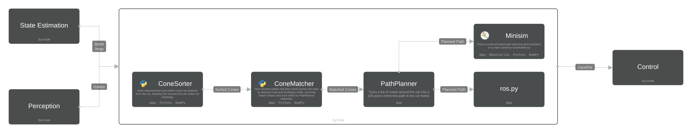

# Path Planning Components

## Cone Sorting

The **ConeSorter** is the first processing component of the Path Planning algorithm. It is called by `PathPlanner.plan()` after cone data is received from Perception or State Estimation and converted into internal `Cone` objects.

Its main purpose is to organise the detected cones by colour and distance from the car, preparing them for the ConeMatcher.

### Inputs

The `sort_cones()` method takes the following inputs:

- **Cones:** A list of `Cone` objects containing their colour and 2D coordinates `(x, y)`.
- **Reference point:** The position used to calculate distances, defaulting to `(0, 0)`, which represents the car's position in its local coordinate frame.
- **Maximum cones per side:** The maximum number of cones to keep for each colour, defaulting to `4`.

### How It Works

1. **Distance calculation:** Calculates the Euclidean distance of each cone from the reference point using `euclidean_distance()` from `mathUtils.py`.
2. **Sorting:** Sorts the cones in ascending order of distance, placing the closest cones first.
3. **Colour separation:** Separates the sorted cones into yellow and blue groups. Orange and unknown cones are excluded from the sorter's output.
4. **Cone selection:** Keeps only the nearest four cones of each colour by default, limiting the number of cones used for matching.

### Outputs

The `sort_cones()` method returns four NumPy arrays:

| Output | Description |
|---|---|
| `yellow_cones_sorted` | Yellow cone objects sorted nearest-first |
| `yellow_distances` | Corresponding distances of the yellow cones |
| `blue_cones_sorted` | Blue cone objects sorted nearest-first |
| `blue_distances` | Corresponding distances of the blue cones |

These arrays are returned to `PathPlanner.plan()`, which passes them to `ConeMatcher.match_cones()` to identify potential yellow-blue cone pairs across the track.

The accepted matches are then used by PathPlanner to calculate centrepoints and generate a smoothed path that is published for the Control team to follow.

**Implementation:** `ft_euclid/ConeSorter.py`

## Mini Simulator

The Path Planning mini simulator is a light weight mini simulator that allows quick checks of algorithm performance before testing with the full FT stack in EUFS. It runs quickly and only needs track_data.npz and the ft_euclid planner code. It's main purpose is to act as a unit test for path planning.

### How to run the mini-sim
1. First run trackbuilder.py, click and drag to make your track. Try to match the end of the track with the start to create a full loop, it should snap to the beginning.

2. Press enter to save the track. This will go to a track_data.npz file.

3. Run path_planner_sim.py, this will read the latest contents of the track_data.npz file and the mini sim should be operational.

### Inputs
path_planner_sim.py takes no command-line arguments. Its input is the track_data.npz file created by trackbuilder.py, which must be in the same directory as path_planner_sim.py. 

track_data.npz contains four named arrays, written by trackbuilder.py’s np.savez() call and read back by name with np.load(). Every point is  (x, y), in metres in the global (track) frame:

- blue_cones: shape (B, 2). Blue cones, 1.5 m left of the centerline.
- yellow_cones: shape (Y, 2). Yellow cones, 1.5 m right of the centerline.
- centerline: shape (M, 2), M ≥ 2. The smoothed track centre, one point every 0.5 m. The sim uses only the first two points, to set the vehicle’s start position and heading.
- big_orange_cones: shape (2, 2). The two start-gate cones. The sim treats this array as optional and uses no orange cones if it’s missing.

Hard-coded parameters include: 10 m lookahead, 0.5 m moved per frame, 0.1 m path-point filter, 120 frames that repeat, 100 ms interval, ±50 m axes.

### Steps
path_planner_py() runs once and sets everything up, including:
- creating a PathPlanner instance
- loading the track from track_data.npz
- converting every cone position into a Cone object in cone_list
- drawing all cones faintly as a static background
- creating the empty plot elements that are updated each frame (vehicle marker, path line, match lines, highlighted matched cones)
- placing the vehicle at centerline[0], heading toward centerline[1]
- registering update() with FuncAnimation and opening the window with plt.show()

After the window opens, all per-frame work happens in update(). path_planner_py() resumes only when the window is closed, and then returns the animation object.
update() is ran every 100 ms. Each call to update() performs one simulation step:
- _transform_visible_cones() keeps cones within 10 m that are in front of the vehicle and converts them into the vehicle frame (x forward, y left). Those cones are passed to planner.plan().
- _build_match_artifacts() converts each matched yellow/blue pair back to the global frame. update() then draws them as magenta lines and highlights the matched cones.
- update()then removes path points within 0.1 m of the vehicle or behind it, converts the rest to the global frame, and draws them starting from the vehicle’s position.
- _advance_vehicle() moves the vehicle 0.5 m toward the first path point and turns it to face along the first path segment. If no valid path points remain, the vehicle creeps 0.15 m straight ahead instead.
- Handle errors: any exception is printed with the frame number and position, and the path line is hidden.

### Outputs
- An interactive animated plot: track cones, the vehicle (red), the planned path (green), cone matches (magenta) and matched cones (cyan and orange).
- Console output: cone counts at startup and any planning errors per frame.
- Return value: the FuncAnimation object, available only after the window is closed.
- No files, metrics or logs are written. track_width is returned by plan() but never used.

### Limitations

| Limitation | Description |
|---|---|
| Separate track generation | Tracks are made by `trackbuilder.py` and saved to `track_data.npz`, which `path_planner_sim.py` then loads. Testing a different track means running `trackbuilder.py` first, then the sim. Both scripts use their own directory for this file, so they must be in the same folder. The sim takes no command-line arguments, so you can't choose a track at launch, and each new track overwrites the last one. |
| Path setup | `sys.path.insert()` runs after the `ft_euclid` imports, so it has no effect. `ft_euclid` must already be importable. |
| Vehicle can get permanently stuck | Once the vehicle fails to move in a frame, the planner gets identical input on every later frame, so it stops for good if the filtered path has only one point, or `plan()` raises an exception, which then prints the same error every frame. |
| Movement and heading differ slightly | The vehicle moves toward the first path point, but its heading is set from the direction between the first and second path points. This may be intended (lining up with the path ahead), but on curves the direction the vehicle moves and the direction it faces differ slightly. |
| Fixed view | The axes are fixed at ±50 m and don't follow the vehicle. This matches `trackbuilder.py`'s drawing area, so it only matters for tracks from other sources. |
| Path Planning scope | The sim doesn't test whether the car can drive the resulting path. It has no vehicle dynamics or steering limits, so path feasibility wouldn't be able to be tested in this mini-sim. |

