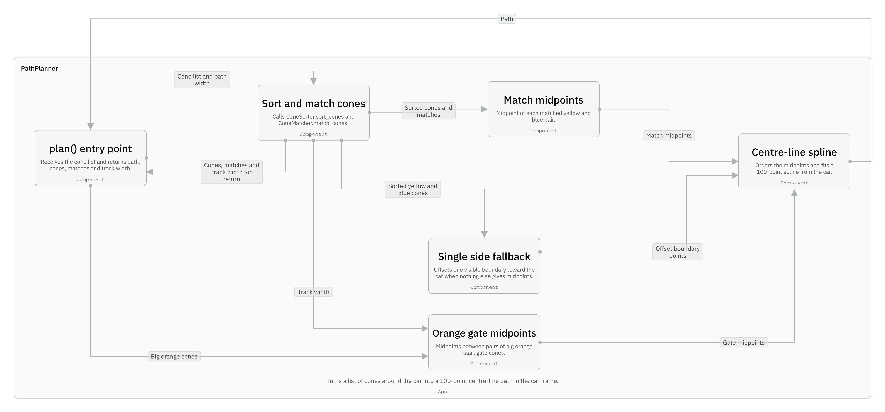

# PathPlanner

PathPlanner turns a list of cone detections into a centre-line path and publishes it on `/raceline` for control to follow. The code is in `ft_euclid` in [FT-FSAI-Core](https://github.com/FT-Autonomous/FT-FSAI-Core), and the entry point is `plan()`. The planner works in a frame where the car sits at the origin, so every position is relative to the car.

Separate pages are planned for the cone sorter, the cone matcher and the minisim.

## Component diagram

{ loading=lazy }

The same diagram is in [IcePanel](https://app.icepanel.io/landscapes/W3k5yfoNP87dJQHdxNC2/versions/latest/diagrams/editor?diagram=I7xmacByVr).

## Inputs and outputs

`plan()` is called as:

```python
path, yellow_cones, blue_cones, matches, track_width = planner.plan(
    cones_data, path_width=5.75
)
```

`cones_data` is a list of `Cone` objects, each with a type and an `(x, y)` position. The types `plan()` uses are `YELLOW`, `BLUE` and `BIG_ORANGE`. The ROS helper also converts small orange cones to `SMALL_ORANGE`, but `plan()` never reads that type.

`path_width` is the maximum spacing allowed for a yellow and blue cone to be treated as a pair. The default is 5.75 m. Passing `None` makes the matcher set the width from the distance between the nearest yellow cone and the nearest blue cone, plus 0.5 m.

The function returns five values. `path` is an `(N, 2)` array of centre-line points, or an empty `(0, 2)` array when no path could be built. `yellow_cones` and `blue_cones` are the sorted, truncated arrays from the sorter. `matches` holds integer index pairs into those arrays, one pair per matched yellow and blue cone. `track_width` is the width the matcher actually used, including a value it derived when `path_width` was `None`.

## How a path is built

### Sorting

A new `ConeSorter` is created with the default cap of 4 cones per side. Cones are sorted by Euclidean distance from the origin, then the nearest 4 yellow cones and the nearest 4 blue cones are kept, together with those distances.

### Matching

A `ConeMatcher` is created with `index_threshold=3` and `width_threshold` set to `path_width`. For each yellow cone it looks for a blue partner within 3 places in the distance-sorted lists. A pair is kept only if the two cones are closer together than the width threshold. If there is nothing to match against, for example when only one side is visible and a width could not be derived, it returns no matches.

### Midpoints

Each kept pair is joined with a line, and the midpoint of that line is added to the centre-point list.

### Orange gate pairing

`find_orange_gate_midpoints` then runs on every cone in `cones_data` whose type is `BIG_ORANGE`, even when yellow and blue midpoints already exist. The matcher only pairs yellow and blue, so the start and finish gate would otherwise be missing from the centre points. Two big orange cones are paired when the distance between them is greater than 2.5 m and less than the current track width. If the matcher could not resolve a width (`track_width` is `None`), the upper limit is dropped and only the 2.5 m minimum applies. The midpoint of each pair is appended to the list.

### Single side fallback

`single_side_fallback` runs only if that list is still empty after matching and orange gate pairing. It needs at least two cones on one colour and none on the other. It walks the visible boundary, takes the local tangent, and offsets each point 1.75 m along the normal that points toward the car. If both colours are present but no midpoints were produced, or if fewer than two cones remain on the only visible side, the fallback returns nothing and `plan()` returns an empty path.

### Centre-line spline

The midpoints are sorted by squared distance from the car. The origin is prepended so the path starts at the car. `splinify.make_spline` then samples 100 points along the curve. With two centre points the result is a straight line. With three or more, the curve is a sequence of quadratic Bézier segments that pass through the midpoints between adjacent centre points, using each intermediate centre point as a control point.

## ROS interface

The ROS 2 node is `PathPlanningVisualiser` (node name `path_planning_visualiser`), started by the `ros` console script in the `ft_path_planning` package. There is no launch file in the package. All of the subscriptions and publishers use a queue size of 1.

| Topic | Type | Role | When it is used |
|---|---|---|---|
| `/cones` | `eufs_msgs/ConeArrayWithCovariance` | subscribed | Perception mode (`use_slam` is false) |
| `/map` | `eufs_msgs/ConeArrayWithCovariance` | subscribed | SLAM mode (`use_slam` is true) |
| `/pose` | `geometry_msgs/PoseStamped` | subscribed | SLAM mode, for the car position and yaw |
| `/raceline` | `eufs_msgs/PointArrayStamped` | published | The planned path, `frame_id` `base_footprint` |
| `/marker` | `visualization_msgs/MarkerArray` | published | RViz markers, `frame_id` `/base_footprint` |

The `use_slam` parameter is a boolean and defaults to `false`. It is read once at startup into `enable_slam`. When it is false, each `/cones` message is converted to `Cone` objects and passed to a new `PathPlanner`. If the cone array is empty, if `plan()` raises, or if the returned path has fewer than 2 points, nothing is published. Otherwise the path is published on `/raceline` with no timestamp, old markers are cleared with `DELETEALL`, red spheres are drawn on the path waypoints, and blue line strips are drawn between each matched yellow and blue cone, all in the `ft_line` namespace. After a successful perception publish, `use_slam` is set back to `enable_slam`.

When `use_slam` is true, `/cones` is ignored. `/map` cones are transformed into the car frame and passed to a reused `PathPlanner` instance, with `path_width` taken from the node (initially 5.75 m, then whatever `plan()` last returned as `track_width`). Replanning is limited to once every 0.5 s. The path and cones are stored in the odom frame and transformed back into the current `base_footprint` frame on every `/map` callback, so a cached plan stays aligned with the car between replans. A SLAM path is treated as invalid if it has fewer than 5 points or any point with `x < 0`. In that case the node logs a warning, sets `use_slam` to `false`, and does not publish, so the next `/cones` message can be used instead. A valid SLAM `/raceline` message includes a timestamp, and only points with `x > 0` are published. The SLAM marker array uses the same sphere and line-strip shapes, but it is not cleared with `DELETEALL` first.

`/pose` must have arrived before SLAM planning runs. Empty `/map` arrays are skipped.

## Parameters

| Name | Default | Where it is set |
|---|---|---|
| `path_width` | 5.75 m | Argument to `plan()`. The node also holds this value and, in SLAM mode, overwrites it with the `track_width` returned by `plan()`. Pass `None` to derive it from the nearest yellow and blue cones plus 0.5 m. |
| `max_cones_per_side` | 4 | `ConeSorter` default, used because `plan()` constructs the sorter with no arguments |
| `index_threshold` | 3 | Passed to `ConeMatcher` from `plan()` |
| `min_gap` | 2.5 m | Lower distance bound for pairing big orange cones in `find_orange_gate_midpoints` |
| fallback `offset` | 1.75 m | Fixed offset in `single_side_fallback`. It is not computed from `track_width`. |
| spline `points` | 100 | Passed to `splinify.make_spline` |
| `use_slam` | `false` | ROS parameter on `path_planning_visualiser` |
| `path_update_interval` | 0.5 s | SLAM replanning period in the node |
| `reference_point` | `(0, 0)` | Car origin used by `PathPlanner` when sorting |

## Running and testing

The minisim is under `src/ft_path_planning/simulator`. From that directory, run `trackbuilder.py`, draw a track by clicking and dragging, close the loop so the end snaps to the start, and press Enter to write `track_data.npz`. Then run `path_planner_sim.py`. The sim transforms the saved cones into the car frame, keeps those within 10 m and in front of the car, and passes them to `plan()`.

```bash
cd src/ft_path_planning/simulator
python3 trackbuilder.py
python3 path_planner_sim.py
```

On the full stack, start the node with the `ros` console script (`ros2 run ft_path_planning ros`) and, in RViz, display `/raceline` and `/marker`. In perception mode you should see the red path spheres and the blue match lines, with previous markers cleared on each successful plan. A path with fewer than two points is not published.

`src/ft_path_planning/Tests/` currently contains only a stub README. The package Makefile has a `make unittest` target that runs `python -m unittest`, but there are no unit test modules in that folder yet.

## Source

- [PathPlanner.py](https://github.com/FT-Autonomous/FT-FSAI-Core/blob/main/src/ft_path_planning/ft_euclid/PathPlanner.py)
- [ConeSorter.py](https://github.com/FT-Autonomous/FT-FSAI-Core/blob/main/src/ft_path_planning/ft_euclid/ConeSorter.py)
- [ConeMatcher.py](https://github.com/FT-Autonomous/FT-FSAI-Core/blob/main/src/ft_path_planning/ft_euclid/ConeMatcher.py)
- [splinify.py](https://github.com/FT-Autonomous/FT-FSAI-Core/blob/main/src/ft_path_planning/ft_euclid/Utils/splinify.py)
- [ros.py](https://github.com/FT-Autonomous/FT-FSAI-Core/blob/main/src/ft_path_planning/ft_euclid/rosplugin/ros.py)
- [ros_utilities.py](https://github.com/FT-Autonomous/FT-FSAI-Core/blob/main/src/ft_path_planning/ft_euclid/rosplugin/ros_utilities.py)
- [simulator](https://github.com/FT-Autonomous/FT-FSAI-Core/tree/main/src/ft_path_planning/simulator)
- [Tests](https://github.com/FT-Autonomous/FT-FSAI-Core/tree/main/src/ft_path_planning/Tests)
