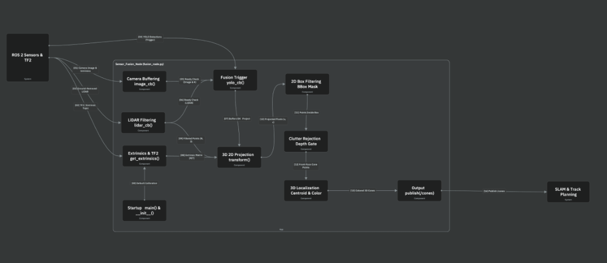

# `fusion_node.py` — Step-by-Step Function Documentation

**Source File:** `FT-FSAI-Core/src/ft_misperception/src/ft_misperception/fusion_node.py`  
**ROS 2 Node Name:** `Sensor_Fusion_Node` (implemented by `Wrapper`, lines 75–605)  
**IcePanel Flow Diagram:** [https://s.icepanel.io/0EhhOOxmUeQQ74/0HPf](https://s.icepanel.io/0EhhOOxmUeQQ74/0HPf)

---

## Main Execution Flow (IcePanel Steps `[00]`–`[14]`)

### Step 1: Function `main()` & `Wrapper.__init__()`, purpose: Initialize the ROS 2 fusion node, parameters, pub/sub interfaces, and default extrinsic calibration.
*(IcePanel Flow: `[00] Default Calibration`)*
- Function `main()` (lines 608–612) & `Wrapper.__init__()` (lines 129–240) requests ROS 2 node parameters (topic names, coordinate frames, runtime flags, `extrinsic_params`) and `DEFAULT_EXTRINSIC_PARAMS` (`JULY_10_BEST_EXTRINSIC_PARAMS` from `ft_misperception.calibration`).
- What it does to the data: Initializes `rclpy`, instantiates and spins `Wrapper` (`Sensor_Fusion_Node`), declares 16 ROS 2 parameters, registers 7 topic subscriptions and 1 publisher (`/cones`), creates the TF2 `Buffer` and `TransformListener`, defines class label IDs (`YELLOW=0`, `ORANGE=1`, `BIG_ORANGE=2`, `BLUE=3`, `OTHER=4`), and converts `self.extrinsic_params` into the initial $3 \times 4$ `self.extrinsic_matrix` via `extrinsic_matrix_from_extrinsic_calibration_params()`.
- Outputs: Running `Sensor_Fusion_Node` with initialized state buffers (`self.image = None`, `self.intrinsic_matrix = None`, `self.lidar = None`, `self.bounding_boxes = []`, `self.labels = None`) and default $3 \times 4$ extrinsic matrix `[R | T]` (`[00] Default Calibration`).

### Step 2: Function `image_cb(data)` & `camera_info_cb(data)`, purpose: Buffer the rectified camera frame and camera intrinsic matrix $K$.
*(IcePanel Flow: `[01] Camera Image & Intrinsics` $\rightarrow$ `[05] Ready Check (Image & K)`)*
- Function `image_cb(data)` (lines 265–287) & `camera_info_cb(data)` (lines 289–299) requests `sensor_msgs/Image` on `image_topic` (default `/zed2i/zed_node/left/image_rect_color`) and `sensor_msgs/CameraInfo` on `camera_info_topic` (default `/zed2i/zed_node/left/camera_info`) from `ROS 2 Sensors & TF2` (`[01]`).
- What it does to the data: `image_cb(data)` reshapes raw `data.data` into `(height, width, 3)` for `bgr8`/`rgb8` or slices away the alpha channel from `(height, width, 4)` for `bgra8`/`rgba8`, reversing channels (`[:, :, ::-1]`) for `rgb8`/`rgba8` to standardize on BGR (logging a throttled error on unsupported encodings). `camera_info_cb(data)` extracts the 9-element row-major array `data.k` and reshapes it into a $3 \times 3$ intrinsic matrix $K$.
- Outputs: Buffered `self.image` (`(H, W, 3)` BGR NumPy array) and `self.intrinsic_matrix` (`(3, 3)` NumPy array $K$) available for `[05] Ready Check (Image & K)`.

### Step 3: Function `lidar_cb(msg)`, purpose: Unpack and forward-filter the 3D ground-removed LiDAR point cloud.
*(IcePanel Flow: `[02] Ground-Removed LiDAR` $\rightarrow$ `[06] Ready Check (LiDAR)` & `[09] Filtered Points (N, 3)`)*
- Function `lidar_cb(msg)` (lines 323–335) requests `sensor_msgs/PointCloud2` on `lidar_projection_topic` (default `/cluster/ransac_base`) from `ROS 2 Sensors & TF2` (`[02]`).
- What it does to the data: Unpacks binary `[x, y, z]` point coordinates while removing `NaN`/non-finite rows via `read_lidar_points(msg, field_names=['x', 'y', 'z'], skip_nans=True)`, then applies `point_filter_mask(self.lidar, min_distance=0.0)` to filter out points behind the LiDAR sensor ($x < 0$).
- Outputs: Filtered 3D point cloud `self.lidar` of shape `(N, 3)` supplying `[06] Ready Check (LiDAR)` and `[09] Filtered Points (N, 3)`.

### Step 4: Function `extrinsic_calibration_parameters_cb(data)`, `get_extrinsic_calibration_parameters_from_tf2()`, & `quaternion_to_euler_angles(quaternion)`, purpose: Maintain the $3 \times 4$ LiDAR-to-camera extrinsic matrix $[R \mid T]$.
*(IcePanel Flow: `[03] TF2 / Extrinsic Topic` $\rightarrow$ `[08] Extrinsic Matrix [R|T]`)*
- Function `extrinsic_calibration_parameters_cb(data)` (lines 337–351), `get_extrinsic_calibration_parameters_from_tf2()` (lines 353–386), & `quaternion_to_euler_angles(quaternion)` (lines 42–59) requests a 6-element `std_msgs/Float64MultiArray` `[roll, pitch, yaw, x, y, z]` on `extrinsic_topic` (default `/extrinsic_calib_param`), or a TF2 transform from `source_frame` (`velodyne`) to `target_frame` (`zed2i_left_camera_optical_frame`) via `self.tf_buffer.lookup_transform()` when `use_tf_extrinsics=True` (`[03]`).
- What it does to the data: `extrinsic_calibration_parameters_cb(data)` checks `len(data.data) == 6` and recomputes `self.extrinsic_params` and `self.extrinsic_matrix` via `extrinsic_matrix_from_extrinsic_calibration_params()`. When TF2 extrinsics are enabled, `get_extrinsic_calibration_parameters_from_tf2()` looks up the transform, converts its `[x, y, z, w]` quaternion into `[roll, pitch, yaw]` radians via `quaternion_to_euler_angles(quaternion)`, appends `[tx, ty, tz]`, and `fuse_and_publish()` builds the $3 \times 4$ matrix `[R | T]`.
- Outputs: Updated $3 \times 4$ `self.extrinsic_matrix` (`[R | T]`) feeding `[08] Extrinsic Matrix [R|T]`.

### Step 5: Function `yolo_cb(msg)` & readiness gate in `fuse_and_publish()`, purpose: Unpack 2D cone detections, verify sensor buffers, and trigger fusion.
*(IcePanel Flow: `[04] YOLO Detections (Trigger)`, `[05] Ready Check (Image & K)`, `[06] Ready Check (LiDAR)` $\rightarrow$ `[07] Buffers OK - Project`)*
- Function `yolo_cb(msg)` (lines 301–321) & readiness gate in `fuse_and_publish()` (lines 422–473) requests `zed_interfaces/ObjectsStamped` on `objects_topic` (default `/stamped_objects`) (`[04]`), plus buffer availability checks against `self.image` & `self.intrinsic_matrix` (`[05]`) and `self.lidar` (`[06]`).
- What it does to the data: `yolo_cb(msg)` resets `self.bounding_boxes = []` and `self.labels = []`, iterates through `msg.objects` extracting each object's 4 `bounding_box_2d.corners` keypoints and `label_id`, and invokes `self.fuse_and_publish()`. The readiness gate checks that `self.lidar`, `self.intrinsic_matrix`, and `self.image` are not `None` (returning early with throttled debug logs otherwise), and optionally refreshes `self.extrinsic_matrix` from TF2 if `use_tf_extrinsics=True`.
- Outputs: Populated `self.bounding_boxes` and `self.labels`, and validated sensor readiness triggering projection (`[07] Buffers OK - Project`).

### Step 6: Function `transform(points)` & `H(points)`, purpose: Project 3D LiDAR points onto 2D image pixel coordinates $(u, v)$.
*(IcePanel Flow: `[07] Buffers OK - Project`, `[08] Extrinsic Matrix [R|T]`, `[09] Filtered Points (N, 3)` $\rightarrow$ `[10] Projected Pixels (u, v)`)*
- Function `transform(points)` (lines 475–487) & `H(points)` (lines 61–73) requests filtered 3D point cloud `self.lidar` `(N, 3)` (`[09]`), $3 \times 4$ `self.extrinsic_matrix` `[R | T]` (`[08]`), and $3 \times 3$ `self.intrinsic_matrix` $K$.
- What it does to the data: `H(points)` horizontally stacks a column of ones onto `points[:, :3]` to create `(N, 4)` homogeneous coordinates $[x, y, z, 1]$. `transform(points)` applies the pinhole projection `(self.intrinsic_matrix @ self.extrinsic_matrix @ H(points).T).T`, performs perspective division by camera depth `transformed[:, 2, np.newaxis]`, and slices the first two columns `(u, v)`. *(If `enable_plots=True`, lines 489–511 also overlay `tfl` onto `self.image` via Matplotlib.)*
- Outputs: 2D projected pixel coordinate array `tfl` of shape `(N, 2)` (`[10] Projected Pixels (u, v)`).

### Step 7: Function `fuse_and_publish()` — 2D Box Filtering (BBox Mask), purpose: Associate 3D LiDAR points with each 2D YOLO bounding box.
*(IcePanel Flow: `[10] Projected Pixels (u, v)` $\rightarrow$ `[11] Points Inside Box`)*
- Function `fuse_and_publish()` (lines 521–536) requests projected 2D pixel coordinates `tfl` (`[10]`), 3D points `self.lidar`, and each detection's top-left corner `self.bounding_boxes[i][0].kp` $(u_{\min}, v_{\min})$ and bottom-right corner `self.bounding_boxes[i][2].kp` $(u_{\max}, v_{\max})$.
- What it does to the data: For each cone index `i`, evaluates a boolean mask `(tfl[:, 0] > u_min) * (tfl[:, 0] < u_max) * (tfl[:, 1] > v_min) * (tfl[:, 1] < v_max)` and slices `self.lidar`. If zero points fall inside the bounding box, it skips the detection (`continue`).
- Outputs: Candidate 3D points `bounding_box_points_3d` of shape `(M, 3)` inside bounding box `i` (`[11] Points Inside Box`).

### Step 8: Function `fuse_and_publish()` — Clutter Rejection (Depth Gate), purpose: Filter out background points behind the cone inside each 2D frustum.
*(IcePanel Flow: `[11] Points Inside Box` $\rightarrow$ `[12] Front-Face Cone Points`)*
- Function `fuse_and_publish()` (lines 538–553) requests candidate 3D points `bounding_box_points_3d` (`[11]`).
- What it does to the data: Computes Euclidean distance `distances = np.linalg.norm(bounding_box_points_3d, axis=1)` from the LiDAR origin, computes `counts, _ = np.histogram(distances)`, and when `counts.sum() > 0`, keeps only points within the closest 20% of the distance span: `distances < (dmin + (dmax - dmin) / 5)`. If no points remain, logs a throttled warning (`"Cone with no virtual points"`) and skips the cone.
- Outputs: Foreground-filtered 3D cone points `bounding_box_points_3d` (`[12] Front-Face Cone Points`).

### Step 9: Function `fuse_and_publish()` — 3D Localization (Centroid & Color), purpose: Compute each cone's 3D centroid and assign its YOLO color class.
*(IcePanel Flow: `[12] Front-Face Cone Points` $\rightarrow$ `[13] Colored 3D Cones`)*
- Function `fuse_and_publish()` (lines 555–579) requests filtered front-face 3D points `bounding_box_points_3d` (`[12]`) and YOLO class ID `self.labels[i]`.
- What it does to the data: Computes `center.x` and `center.y` as the mean across `bounding_box_points_3d` along `axis=0`, sets `center.z = bounding_box_points_3d[:, 2].min()` (anchoring height to the cone base), wraps `center` in `ConeWithCovariance(point=center)`, and appends it to `msg.yellow_cones` (`0`), `msg.orange_cones` (`1`), `msg.big_orange_cones` (`2`), `msg.blue_cones` (`3`), or `msg.unknown_color_cones` (`else`) based on `self.labels[i]`.
- Outputs: Color-classified 3D cone entries accumulated in `msg` (`eufs_msgs/ConeArrayWithCovariance`) (`[13] Colored 3D Cones`).

### Step 10: Function `fuse_and_publish()` — Output & Optional `lidar_cone_cb(data)`, purpose: Stamp, optionally merge LiDAR-only candidates, and publish final 3D cones.
*(IcePanel Flow: `[13] Colored 3D Cones` $\rightarrow$ `[14] Publish /cones`)*
- Function `fuse_and_publish()` (lines 581–605) & `lidar_cone_cb(data)` (lines 254–263) requests the colored 3D cones in `msg` (`[13]`), current node clock time, `publish_frame` (default `"velodyne"`), and optionally `self.lidar_cone_msg` cached by `lidar_cone_cb(data)` from `lidar_cones_topic` (default `/cones/lidar`).
- What it does to the data: Sets `msg.header.stamp` and `msg.header.frame_id`. If `forward_lidar_candidates=True` and `self.lidar_cone_msg` is not `None`, concatenates all five cone color lists from `self.lidar_cone_msg` into `msg` and resets `self.lidar_cone_msg = None`. Publishes `msg` via `self.fused_cone_publisher.publish(msg)` and emits debug counts and execution time when `DEBUG` logging is enabled.
- Outputs: Published `eufs_msgs/ConeArrayWithCovariance` message on `fused_cones_topic` (default `/cones`) to `SLAM & Track Planning` (`[14] Publish /cones`).

---

## Auxiliary / Uncalled Functions in `fusion_node.py`

### Function `plane_params_cb(data)`, purpose: Cache ground plane model coefficients from the RANSAC node.
- Function `plane_params_cb(data)` (lines 242–251) requests `std_msgs/Float64MultiArray` on `plane_model_topic` (default `/cluster/plane_model`).
- What it does to the data: Converts `data.data` (`[a, b, c, d]` for `ax + by + cz + d = 0`) into a NumPy array.
- Outputs: Stores the plane coefficients in `self.plane_params`.

### Function `calculate_plane_rotation()`, purpose: Compute a rotation matrix aligning the ground plane normal with the vertical Z-axis *(currently uncalled in the main fusion loop)*.
- Function `calculate_plane_rotation()` (lines 388–420) requests `self.plane_params[:3]` (ground plane normal vector).
- What it does to the data: Normalizes `plane_normal`, computes the rotation axis via cross product with `[0.0, 0.0, 1.0]`, computes the rotation angle via dot product, builds the $3 \times 3$ skew-symmetric matrix $K$, and applies Rodrigues' rotation formula $R = I + \sin(\theta)K + (1 - \cos(\theta))K^2$ (returning `None` if `self.plane_params` is missing/invalid or `np.eye(3)` if already aligned).
- Outputs: A `(3, 3)` rotation `np.ndarray` or `None`.
