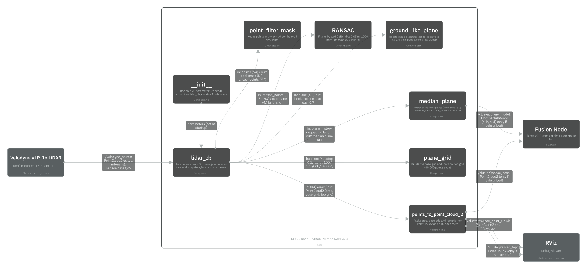

# RANSAC Node

## Overview

## Node Summary

This Node subscribes to the point clouds produced by the car's LiDAR and uses RANSAC to fit a plane to the ground in front of the car. The plane is published on `/cluster/plane_model`, along with a grid of points lying on it, for the Fusion Node to use.

## Subscriptions (Inputs)

- `/velodyne_points`

## Publications (Outputs)

- `/cluster/plane_model`
- `/cluster/ransac_base`
- `/cluster/ransac_top`
- `/cluster/ransac_point_cloud`
