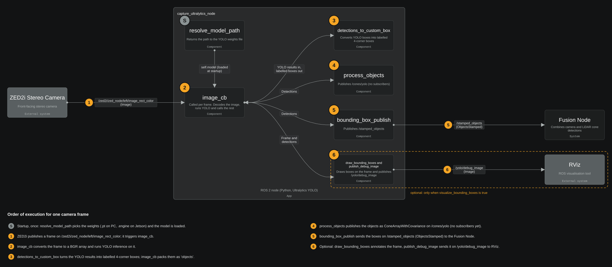

# YOLO Capture Node

## Overview

## Node Summary

This Node subscribes to the images produced by the car's Stereo Camera and calls a YOLO model to produce labelled boxes for cones. These boxes are converted into 4-corner boxes and published on `/stamped_objects`. We also have the option of drawing the boxes onto the images for debugging purposes.

## Subscriptions (Inputs)

- `/zed2i/zed_node/left/image_rect_color`

## Publications (Outputs)

- `/stamped_objects`
- `/cones/yolo`
- `/yolo/debug_image`

## Parameters

- `image_topic`
- `frame`
- `model_path`
- `conf_thres`
- `iou_thres`
- `visualize_bounding_boxes`
- `show_bounding_box_window`
- `debug_image_topic`

## Step-by-Step Processing

### Startup

When the Node starts up, `resolve_model_path` finds the YOLO weights file given by `model_path`. An object of the `YOLO` class from the `ultralytics` library is then created and the path to the YOLO weights is passed to it.

### 1. Receiving the Camera Frame

The camera publishes frames regularly on `/zed2i/zed_node/left/image_rect_color`. This node subscribes to this topic so it is called each time that the camera captures a new frame. The `image_cb` function is called each time a new frame arrives.

### 2. Image Conversion and YOLO Inference

`image_cb` first converts the frame into a BGR `numpy` array (frames in an unsupported encoding are skipped). It then passes the frame to the YOLO model we defined at startup, along with `conf_thres` and `iou_thres`. The model returns a list with one `Results` object for the frame. Its `boxes` attribute holds every detected cone (its pixel corners, its class and its confidence).

### 3. Converting Detections

`detections_to_custom_box` is called to convert the boxes that YOLO produced into 4-corner boxes. To do this, it takes the two corners provided by YOLO (top-left and bottom-right), and converts them into 4 corners. Tensors are converted to plain Python values and the result is stored in an `sl.CustomBoxObjectData` object.

### 4. Cone Publishing

`process_objects` publishes a list of cones it found, sorted by colour to `/cones/yolo`. This topic is currently not subscribed to by any other Node and may need to be removed in the future.

### 5. Bounding Box Publishing

The `bounding_box_publish` function publishes the list of bounding box object we created earlier to `/stamped_objects`. Each `Object` has two fields filled in, `label_id` (The YOLO class number) and `bounding_box_2d.corners` (The four corners of each box).

### 6. Debug Image (Optional)

If the `visualize_bounding_boxes` parameter is set to `True` (the default), we publish a debug image which consists of the original frame with the YOLO boxes drawn on. `draw_bounding_boxes` draws each box onto the frame in its cone's colour, labelled with its class number. `publish_debug_image` then publishes these frames to `/yolo/debug_image`.

## Coordinate System

The image origin `(0, 0)` is the top-left corner, with x increasing to the right and y increasing downwards. Box corners are always in the order A (top-left), B (top-right), C (bottom-right), D (bottom-left).
