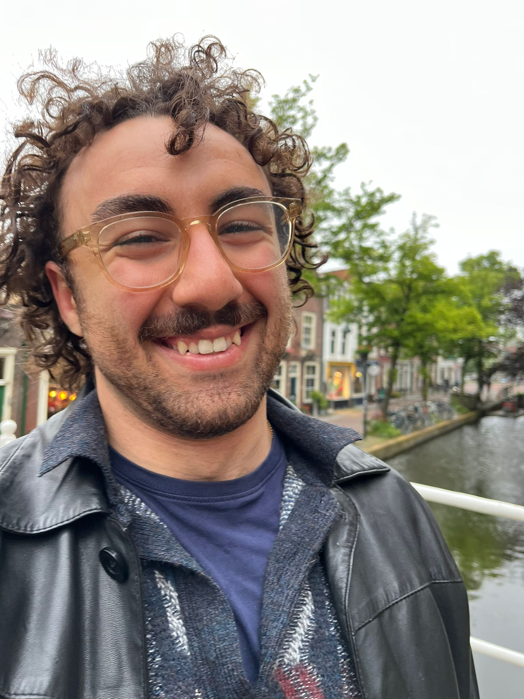
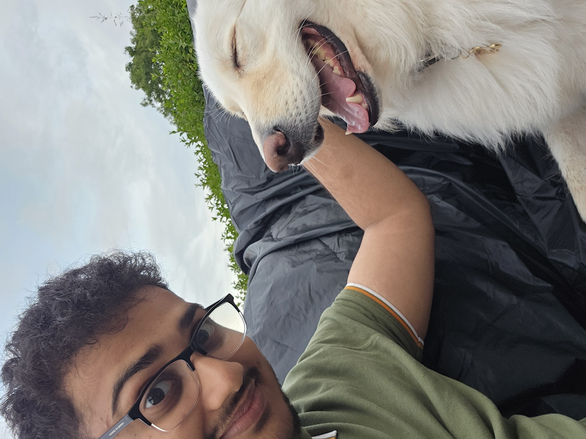

# Hall of Fame

Celebrating the people who built Formula Trinity Autonomous, and kept it going from one team to the next.

[Back to Home](index.md)

---

## 2018/19 and 2019/20: The Early Project

Autonomous began in late 2018. The early team leaders still need confirming.

---

## 2020/21: Founding Group

The Autonomous racing group was founded in 2020 by **Andrew Dai, Jakub Pyszka, Senan Stanley and Katherine Hardgrave**.

<figure>
  
  <figcaption><strong>Andrew Dai</strong>Co-Founder</figcaption>
</figure>
<figure>
  
  <figcaption><strong>Jakub Pyszka</strong>Co-Founder</figcaption>
</figure>
<figure>
  
  <figcaption><strong>Senan Stanley</strong>Co-Founder</figcaption>
</figure>
<figure>
  
  <figcaption><strong>Katherine Hardgrave</strong>Co-Founder</figcaption>
</figure>

We qualified for and competed in **F1TENTH IROS 2020**, alongside 17 other teams. We then co-hosted the **AI Grand Prix in 2021** with F1TENTH and Riders.ai, bringing together **23 robotics teams** for a virtual autonomous racing competition.

---

## 2021/22

<figure>
  
  <figcaption><strong>Daniel Flood</strong>Team Coordinator</figcaption>
</figure>
<figure>
  
  <figcaption><strong>Katherine Hardgrave</strong>Head of Engineering</figcaption>
</figure>

We finished **4th at the in-person F1TENTH IROS 2021 competition**, then made our first FSUK appearance in 2022 as Ireland's first FS-AI team. We placed **7th in DDT** and **1st in Real World AI**. The wider Formula Trinity team also received the **Allan Staniforth Best Newcomer** and **Racing Pride Aston Martin Diversity and Inclusion** awards.

---

## 2022/23

<figure>
  
  <figcaption><strong>Emran Yasser Moustafa</strong>Captain</figcaption>
</figure>
<figure>
  
  <figcaption><strong>Chinaza Uzoukwu</strong>CTO <small>From November 2022</small></figcaption>
</figure>

At **FSUK 2023**, we finished **16th overall** and **2nd in Real World AI**. We also moved from camera-only perception to a LiDAR-based solution, using the Livox Avia to detect cones.

---

## 2023/24

<figure>
  
  <figcaption><strong>Advik Bahadur</strong>Captain</figcaption>
</figure>
<figure>
  
  <figcaption><strong>Chinaza Uzoukwu</strong>CTO</figcaption>
</figure>

At **FSUK 2024**, we finished **13th overall** and won the **TATA ELXSI FS-AI Autonomous Design award**, our first win in that event. The design brought camera and LiDAR perception together through sensor fusion. We also picked up the **FS-AI Most Cones Collected** award.

---

## 2024/25

<figure>
  
  <figcaption><strong>Cleavon Castelino</strong>Captain</figcaption>
</figure>
<figure>
  
  <figcaption><strong>Chinaza Uzoukwu</strong>CTO</figcaption>
</figure>

At **FSUK 2025**, we finished **12th overall** and **2nd in Autonomous Engineering Design**. After debugging right up to the end of competition, we got the car making a turn. The wider team also received the **Racing Pride Aston Martin Diversity and Inclusion award** again.

---

## 2025/26

<figure>
  
  <figcaption><strong>Jake Casserly</strong>Captain</figcaption>
</figure>
<figure>
  
  <figcaption><strong>Dhruv Ranajit Choudhury</strong>CTO / Head of Engineering</figcaption>
</figure>

At **FSUK 2026**, we completed **Trackdrive for the first time: 10 laps without hitting a single cone**. We also completed **Sprint for the first time**, finishing **4th in Trackdrive**, **joint 5th in Sprint** and **5th overall**, our best FS-AI result yet.

We finished **1st in Real World AI**, winning the **Atlassian Williams F1 Team Real World AI award**, and **Gerry Byrne** received the **HAAS Faculty Advisor Outstanding Contribution award**.

---

## 2026/27

<figure>
  
  <figcaption><strong>Joel Jojan</strong>Software Captain</figcaption>
</figure>
<figure>
  
  <figcaption><strong>Adam Walsh</strong>Systems Captain</figcaption>
</figure>
<figure>
  
  <figcaption><strong>Conor Moran</strong>CTO</figcaption>
</figure>

Systems was created to develop the new Internal Combustion car's autonomous systems. The CTO covers both halves of the team: **Software and Systems**.
